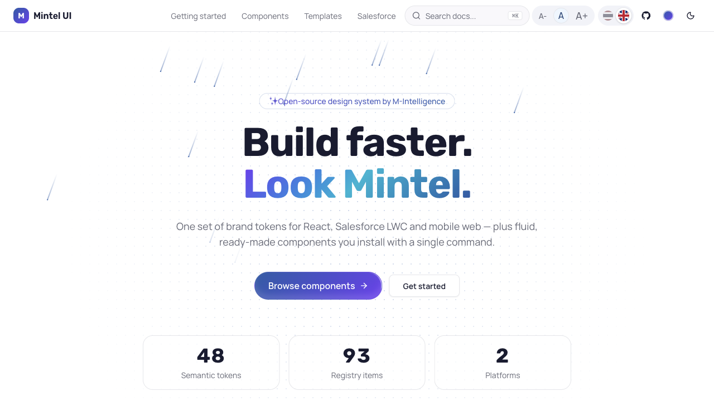

# Mintel UI

[](https://github.com/mintelligence-dev/mintel-magicui/actions/workflows/ci.yml)
[](https://github.com/mintelligence-dev/mintel-magicui/tags)
[](LICENSE)

The open-source design system of [M-Intelligence](https://m-intelligence.tech): one set of brand tokens for
**React** and **Salesforce Lightning Web Components**, plus ready-made components you install with one command.

Design system แบบ open source ของ M-Intelligence: brand tokens ชุดเดียวใช้ได้ทั้ง React และ Salesforce LWC
พร้อม component สำเร็จรูปที่ติดตั้งได้ด้วยคำสั่งเดียว เอกสารมีทั้งภาษาอังกฤษและภาษาไทย

**[Docs](https://mintel-ui.vercel.app)** · **[เอกสารภาษาไทย](https://mintel-ui.vercel.app/th)** ·
[Components](https://mintel-ui.vercel.app/components) · [Salesforce](https://mintel-ui.vercel.app/salesforce) ·
[Changelog](https://mintel-ui.vercel.app/changelog)

[](https://mintel-ui.vercel.app)

## What you get

- **React components** through a [shadcn registry](https://ui.shadcn.com/docs/registry): the source is copied
  into your project, so you own it and can edit it. Core UI, forms (including Thai ID, phone and address), data
  tables, navigation, glass, motion, mobile and animated effects.
- **Page sections and [templates](https://mintel-ui.vercel.app/templates)** built from those components.
- **Lightning Web Components** for record pages, KPIs, kanban, timelines, chat and Experience Cloud, with no
  Apex.
- **Design tokens** from one source file (`tokens.json`), generated as CSS variables, a Tailwind v4 theme, a
  shadcn theme, an LWC CSS module and SLDS styling hooks. Light and dark.
- **[Themes](https://mintel-ui.vercel.app/themes)**: Mintel and Clarity, plus a theme builder.
- **Thai and English** text in every component that shows text, Thai by default.
- **For AI coding assistants:** [`/llms.txt`](https://mintel-ui.vercel.app/llms.txt) (index) and
  [`/llms-full.txt`](https://mintel-ui.vercel.app/llms-full.txt) (props, examples, LWC properties).

## Quick start: React / Next.js

Needs a project with Tailwind v4 and shadcn (`npx shadcn@latest init`). Add the registry to `components.json`:

```json
{ "registries": { "@mintel": "https://mintel-ui.vercel.app/r/{name}.json" } }
```

```bash
# 1. Brand theme (colors light/dark, fonts, radius), written into your globals.css
npx shadcn@latest add @mintel/mintel-theme

# 2. Any component
npx shadcn@latest add @mintel/button @mintel/data-table @mintel/thai-address
```

The full steps, including fonts, are in [Getting started](https://mintel-ui.vercel.app/getting-started).

## Quick start: Salesforce

[`packages/salesforce`](packages/salesforce) is a deployable SFDX project: the `c/tokens` CSS module, a static
resource of SLDS styling hooks that rebrands standard `lightning-*` components, and the Mintel LWC.

```bash
git clone https://github.com/mintelligence-dev/mintel-magicui.git && cd mintel-magicui
npm install
sf org login web --alias my-org
npm run deploy:check -w @mintelligence-dev/salesforce -- --target-org my-org   # name conflicts only
npm run deploy -w @mintelligence-dev/salesforce -- --target-org my-org         # checks, then deploys
```

Use a sandbox, scratch org or Developer Edition first. Guide:
[Salesforce getting started](https://mintel-ui.vercel.app/salesforce/get-started). Details:
[`packages/salesforce/README.md`](packages/salesforce/README.md).

## Project status

Mintel UI is at version 0.x: it is in use and under active development, and APIs can still change between minor
versions. The [changelog](https://mintel-ui.vercel.app/changelog) lists every change.

- **React:** every docs page is checked with axe (WCAG 2.1 AA) in CI. Checked at 390px with touch emulation,
  in WebKit and with CPU throttling; not yet tested on real devices or Firefox.
- **Salesforce:** the LWC are covered by jest and compile checks, but **have not been verified in a real org
  yet**. No package version exists; components are deployed from source.
- **npm:** `@mintelligence-dev/tokens` is not published yet. The registry theme delivers the tokens.

## Repository layout

| Path | What it is |
|---|---|
| [`packages/tokens`](packages/tokens) | The token source (`src/tokens.json`) and its generated outputs |
| [`apps/docs`](apps/docs) | Docs site (English `/`, Thai `/th`) and the registry (`public/r/*.json`) |
| [`packages/salesforce`](packages/salesforce) | SFDX project: LWC, tokens module, static resources |

## Develop

```bash
git clone https://github.com/mintelligence-dev/mintel-magicui.git && cd mintel-magicui
npm install
npm run dev        # builds tokens + registry, starts the docs at http://localhost:3000
npm run build      # tokens, registry, static docs; also runs the completeness checks
npm test           # LWC jest tests
```

Needs Node.js 20 or later.

- Change colors and fonts only in `packages/tokens/src/tokens.json`, then `npm run build`.
- `npm run new:component -- <name>` and `npm run new:lwc -- <name>` scaffold every file a new component needs.
- Generated files are committed; CI fails if they are stale.

[CONTRIBUTING.md](CONTRIBUTING.md) has the rules for component code, the checks to run before a pull request
(including the local visual regression run) and how releases are made.

## Versioning

Tokens, the registry and the Salesforce components share one version, managed with
[Changesets](https://github.com/changesets/changesets). Every pull request that changes what people install adds
a changeset (`npx changeset`). Releases are tagged `v<version>`; see [.changeset/README.md](.changeset/README.md).

## Host your own copy

To run the docs and the registry on your own domain, for example to serve a customised theme:

[](https://vercel.com/new/clone?repository-url=https%3A%2F%2Fgithub.com%2Fmintelligence-dev%2Fmintel-magicui&root-directory=apps%2Fdocs&project-name=mintel-ui&repository-name=mintel-ui)

The button copies this repository into your GitHub account and creates a Vercel project with **Root
Directory** set to `apps/docs`. No environment variables are needed.

- The site is a static export; the registry is served at `https://<your-domain>/r/<item>.json`.
- Install commands and registry links on the site use the project's production domain automatically. Set
  `NEXT_PUBLIC_SITE_URL` when you add a custom domain.
- `npx shadcn add` must be able to fetch `/r/*.json` without logging in: keep the production deployment public
  (Vercel Authentication protects preview URLs by default).
- Importing by hand works too: import the repo and set **Root Directory** to `apps/docs` (framework: Next.js).

## Contributing and support

- **Bugs and requests:** [open an issue](https://github.com/mintelligence-dev/mintel-magicui/issues/new/choose).
- **Pull requests** are welcome; start with [CONTRIBUTING.md](CONTRIBUTING.md).
- **Security:** please do not open a public issue. See [SECURITY.md](SECURITY.md).
- Everyone taking part is expected to follow the [Code of Conduct](CODE_OF_CONDUCT.md).

## Credits

Mintel UI stands on other people's open-source work:

- **[Magic UI](https://magicui.design)**: the animated components in `effects/` are adapted from Magic UI (MIT).
- **[shadcn/ui](https://ui.shadcn.com)**: the component structure and the registry format (MIT).
- **[thai-province-data](https://github.com/kongvut/thai-province-data)** by Kongvut Sangkla: the provinces,
  districts, sub-districts and postcodes behind Thai address (MIT).
- **Libraries the components use:** [Radix UI](https://www.radix-ui.com), [TanStack Table and
  Virtual](https://tanstack.com), [React Hook Form](https://react-hook-form.com), [Zod](https://zod.dev),
  [React DayPicker](https://daypicker.dev), [Recharts](https://recharts.org), [Motion](https://motion.dev),
  [cmdk](https://cmdk.paco.me), [Sonner](https://sonner.emilkowal.ski), [Lucide](https://lucide.dev) and
  [Tailwind CSS](https://tailwindcss.com).
- **Fonts:** Manrope, Rubik, IBM Plex Sans Thai and JetBrains Mono (SIL Open Font License).

Copyright notices and license texts are in [THIRD_PARTY_NOTICES.md](THIRD_PARTY_NOTICES.md).

## License

[MIT](LICENSE) © M Intelligence Co., Ltd.

Salesforce, Lightning and Experience Cloud are trademarks of Salesforce, Inc. Mintel UI is an independent
project and is not affiliated with, sponsored by or endorsed by Salesforce.
